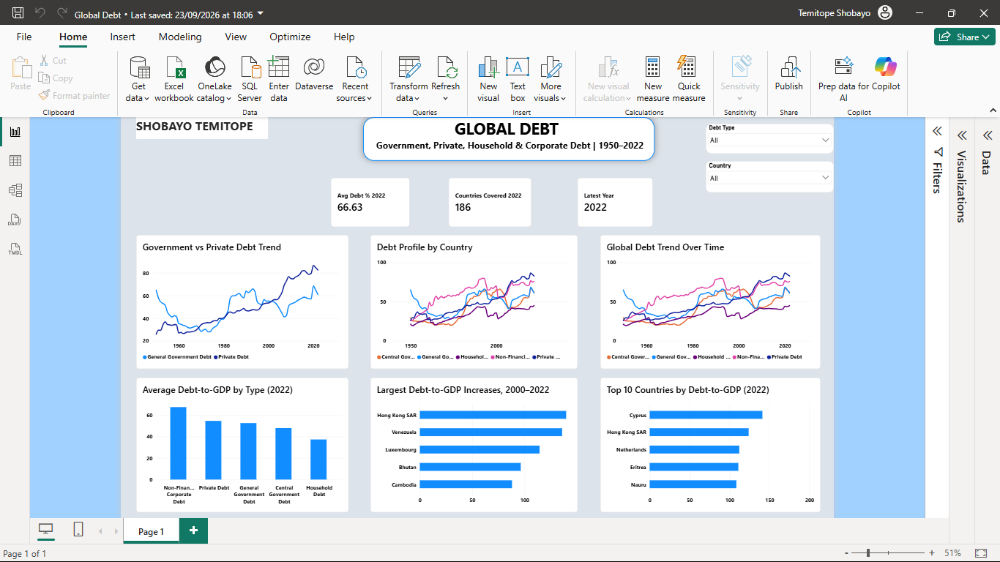

# Global Debt Analysis

## Overview

This Power BI project analyzes global debt data across countries, years, and debt categories. The objective was to transform multiple debt datasets into a consistent analytical structure and build an interactive report for exploring how different forms of debt have changed over time.

The project covers household, corporate, private-sector, general-government, and central-government debt indicators expressed as a percentage of GDP.

## Business Questions

The analysis explores questions such as:

- How has debt changed across countries over time?
- How do household, corporate, and government debt levels compare?
- Which debt categories account for the largest shares of GDP?
- How do debt profiles differ between countries?
- What trends become visible when the data is filtered by year, country, or debt indicator?

## Tools Used

- **Power BI**
- **Power Query**
- **DAX**
- Data transformation
- Data modeling
- Interactive filtering
- Time-series visualization

## Data Preparation

A substantial part of this project involved reshaping the source data before visualization.

### Unpivoting

The original datasets stored yearly observations across multiple columns. These year columns were **unpivoted** in Power Query to create a cleaner structure with year and debt-value fields.

This made the data more suitable for time-series analysis and filtering in Power BI.

### Combining Datasets

Two debt datasets were transformed into compatible structures and combined for analysis.

### Indicator Standardization

The analysis incorporated several debt indicators:

- Private debt from loans and debt securities as a percentage of GDP
- Non-financial corporate debt as a percentage of GDP
- Household debt as a percentage of GDP
- General government debt as a percentage of GDP
- Central government debt as a percentage of GDP

### Data Quality & Structure

Country fields and repeated values were reviewed during transformation to ensure the resulting table behaved correctly in the report.

### Data Type Troubleshooting

A DAX calculation initially encountered a text-versus-integer comparison error when filtering year values. The issue was resolved by correcting the relevant data-type handling before continuing the analysis.

## Report Development

The report was designed to support exploration across several dimensions.

### Debt Trends Over Time

Time-series visuals were used to examine how debt levels changed across years.

### Country Comparison

Country-level analysis allows debt patterns to be compared across economies.

### Debt Indicator Comparison

Different forms of household, corporate, private, and government debt can be explored within the same analytical report.

### Controlled Visual Interactions

Power BI's visual interaction controls were used so that selected slicers could affect specific charts without unnecessarily filtering every visual on the report page.

### Year Presentation

Year formatting was corrected so that dates appeared as actual years rather than abbreviated display values such as "2K".

## Analytical Takeaway

This project demonstrates how data structure directly affects analytical flexibility.

Transforming wide year-based datasets into a long analytical format made it possible to compare countries, years, and debt indicators more effectively. It also enabled a cleaner Power BI model for interactive trend analysis.

The project required both data transformation and report-level troubleshooting, rather than simply importing a prepared dataset and creating charts.

## Dashboard

## Skills Demonstrated

- Power BI report development
- Power Query
- DAX
- Unpivoting data
- Combining datasets
- Data-type troubleshooting
- Data transformation
- Time-series analysis
- Economic and financial data analysis
- Slicer interaction management
- Interactive dashboard development
- Data visualization

---

### About Me

I'm **Temitope Shobayo**, a data analyst working with Excel, Power BI, and SQL to transform raw data into structured analysis and decision-ready insights.

[View my GitHub profile](https://github.com/shawntops) · [Connect with me on LinkedIn](https://www.linkedin.com/in/shobayo/)
